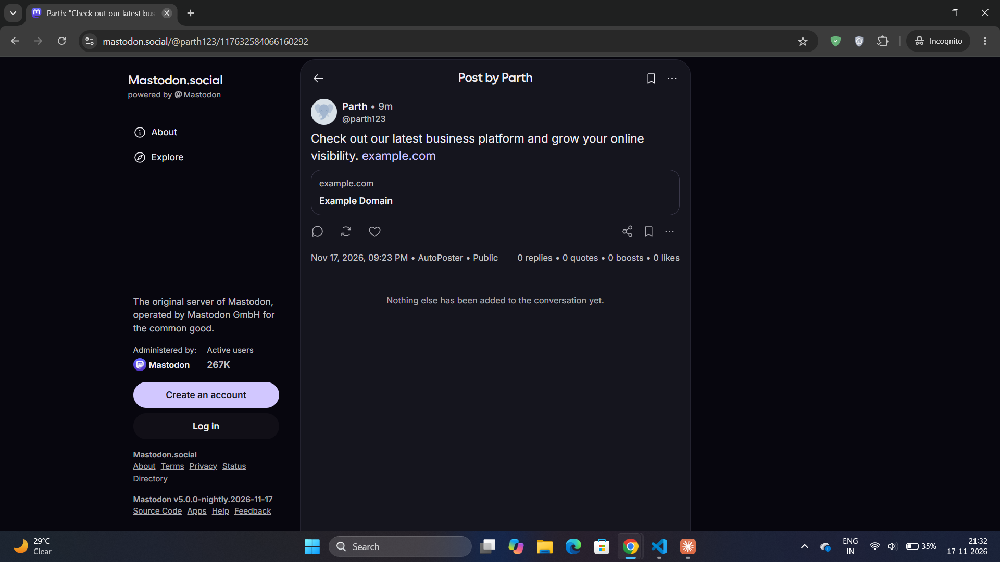
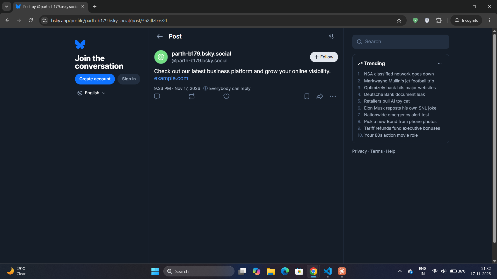
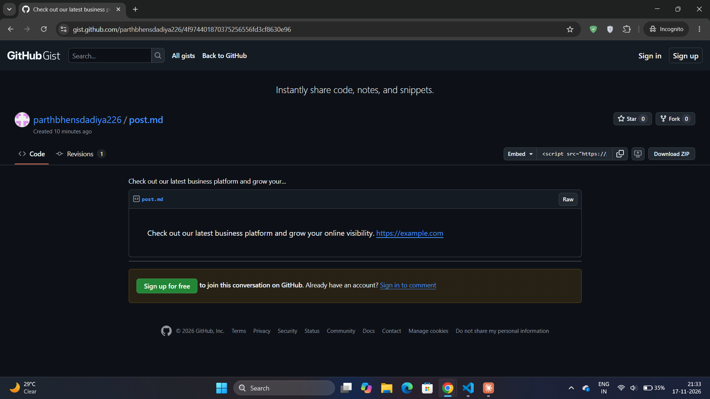

# Automated Multi-Platform Posting System

A FastAPI service with one endpoint, `POST /posting`, that validates a short
message and publishes it to five third-party platforms at the same time. Each
platform is handled independently: if one fails, the others still post.

## Platforms

| Platform | API used | Credentials | Publicly accessible |
|---|---|---|---|
| Mastodon | `POST /api/v1/statuses` | Access token | Yes |
| Bluesky | AT Protocol `createSession` + `createRecord` | Handle + app password | Yes |
| Dev.to | `POST /api/articles` | API key | Yes |
| GitHub Gist | `POST /gists` | Personal access token | Yes |
| Telegraph | `createPage` | Access token | Yes |

Each has a free official API, simple token-based authentication, and returns a
public URL for the published content.

> **Note on Telegraph:** some internet providers in India block `telegra.ph`.
> The page is public and opens normally from other networks or over a VPN;
> the integration itself is unaffected.

## How it works

```text
POST /posting
   |
   v
schemas.py            validate: <= 200 chars, exactly one link, valid URL
   |
   v
posting_service.py    run all platforms concurrently (asyncio.gather)
   |
   v
platforms/*.py        each platform calls its own API
platforms/base.py     catches every error and builds one result per platform
   |
   v
JSON response         one result per platform (success or failed + reason)
```

## Project structure

```text
automated-posting/
├── app/
│   ├── main.py                  # FastAPI app and endpoint
│   ├── schemas.py               # Request/response models and validation
│   ├── config.py                # Settings from environment variables
│   ├── platforms/
│   │   ├── base.py              # Shared error handling and result building
│   │   ├── mastodon.py
│   │   ├── bluesky.py
│   │   ├── devto.py
│   │   ├── github_gist.py
│   │   └── telegraph.py
│   └── services/
│       └── posting_service.py   # Runs all platforms concurrently
├── tests/
│   └── test_posting.py
├── .env.example
├── requirements.txt
└── README.md
```

## Setup

Requires Python 3.10 or newer.

```bash
python -m venv .venv
```

```bash
.venv\Scripts\activate        # Windows
source .venv/bin/activate     # macOS / Linux
```

```bash
pip install -r requirements.txt
```

```bash
copy .env.example .env        # Windows
cp .env.example .env          # macOS / Linux
```

Then fill in `.env`. Any platform left blank is reported as
`"Platform not configured"`.

### Getting credentials

| Platform | Steps |
|---|---|
| Mastodon | Preferences > Development > New application, scope `write:statuses`, copy the access token. Set `MASTODON_BASE_URL` to your instance. |
| Bluesky | Settings > Privacy and security > App passwords > Add. Use your handle (e.g. `name.bsky.social`) and the app password. |
| Dev.to | Settings > Extensions > DEV Community API Keys > Generate. |
| GitHub Gist | Settings > Developer settings > Personal access tokens, scope `gist`. |
| Telegraph | Run the command below and copy `access_token` from the reply. |

```bash
curl "https://api.telegra.ph/createAccount?short_name=AutoPoster&author_name=AutoPoster"
```

## Run

```bash
uvicorn app.main:app --host 0.0.0.0 --port 4000
```

Interactive API documentation: http://localhost:4000/docs

## API

### `POST /posting`

Validation rules for `message`:

- must not be empty
- at most 200 characters
- exactly one link
- the link must be a valid `http://` or `https://` URL with a real domain

#### Sample request

```bash
curl -X POST http://localhost:4000/posting -H "Content-Type: application/json" -d "{\"message\": \"Check out our latest business platform and grow your online visibility. https://example.com\"}"
```

#### Real response (live run on 2026-11-17)

All five platforms published the message. Each `posted_url` is a live, public post
(if the Telegraph link does not load, see the note under [Platforms](#platforms)).

```json
{
  "success": true,
  "results": [
    {
      "platform": "Mastodon",
      "status": "success",
      "posted_url": "https://mastodon.social/@parth123/117632584066160292",
      "public_access": true,
      "date": "2026-11-17",
      "time": "15:53:04",
      "error": null
    },
    {
      "platform": "Bluesky",
      "status": "success",
      "posted_url": "https://bsky.app/profile/parth-b179.bsky.social/post/3n2jflztcez2f",
      "public_access": true,
      "date": "2026-11-17",
      "time": "15:53:05",
      "error": null
    },
    {
      "platform": "Dev.to",
      "status": "success",
      "posted_url": "https://dev.to/parth_bheshdadiya_9190fa8/check-out-our-latest-business-platform-and-grow-your-5h1n",
      "public_access": true,
      "date": "2026-11-17",
      "time": "15:53:04",
      "error": null
    },
    {
      "platform": "GitHub Gist",
      "status": "success",
      "posted_url": "https://gist.github.com/parthbhensdadiya226/4f974401870375256556fd3cf8630e96",
      "public_access": true,
      "date": "2026-11-17",
      "time": "15:53:05",
      "error": null
    },
    {
      "platform": "Telegraph",
      "status": "success",
      "posted_url": "https://telegra.ph/Check-out-our-latest-business-platform-and-grow-your-11-17",
      "public_access": true,
      "date": "2026-11-17",
      "time": "15:53:04",
      "error": null
    }
  ]
}
```

`success` is `true` when at least one platform succeeded. `date` and `time`
are in UTC.

#### When a platform fails

A failed platform does not stop the others. It is returned like this, while
the remaining platforms still report `success`:

```json
{
  "platform": "GitHub Gist",
  "status": "failed",
  "posted_url": null,
  "public_access": false,
  "date": null,
  "time": null,
  "error": "Authentication failed (HTTP 401): Bad credentials"
}
```

#### Validation error responses (HTTP 422)

Two links:

```json
{
  "success": false,
  "errors": [
    {
      "field": "message",
      "message": "Message must contain exactly one CTA link (found 2)."
    }
  ]
}
```

Invalid URL:

```json
{
  "success": false,
  "errors": [
    {
      "field": "message",
      "message": "The CTA link 'http://not_a_domain' is not a valid URL. It must start with http:// or https:// and use a real domain."
    }
  ]
}
```

## Error handling

Every platform call is wrapped by `BasePlatform.post()`, which converts any
problem into a `failed` result instead of raising:

| Situation | `error` value |
|---|---|
| No credentials in `.env` | `Platform not configured (missing credentials)` |
| Wrong token | `Authentication failed (HTTP 401): <platform message>` |
| Too many requests | `Rate limit exceeded (HTTP 429)` |
| Platform too slow | `Request timed out` |
| No internet / DNS failure | `Network error: ConnectError` |
| Unexpected reply | `Unexpected response format from platform` |

Error messages never include tokens.

## Tests

```bash
pytest -v
```

The tests mock every platform API with `respx`, so nothing is really posted.

## Server log from the live run

The log for the request shown above. All five platforms run concurrently, so
they finish in whatever order their APIs reply. Log times are local (IST,
UTC+5:30); the API response reports UTC.

```text
INFO:     Started server process [19928]
INFO:     Waiting for application startup.
INFO:     Application startup complete.
INFO:     Uvicorn running on http://0.0.0.0:4000 (Press CTRL+C to quit)
INFO:     127.0.0.1:49672 - "GET /docs HTTP/1.1" 200 OK
INFO:     127.0.0.1:49672 - "GET /openapi.json HTTP/1.1" 200 OK
2026-11-17 21:23:04,416 INFO HTTP Request: POST https://api.telegra.ph/createPage "HTTP/1.1 200 OK"
2026-11-17 21:23:04,423 INFO Telegraph: posted to https://telegra.ph/Check-out-our-latest-business-platform-and-grow-your-11-17
2026-11-17 21:23:04,469 INFO HTTP Request: POST https://dev.to/api/articles "HTTP/1.1 201 Created"
2026-11-17 21:23:04,471 INFO Dev.to: posted to https://dev.to/parth_bheshdadiya_9190fa8/check-out-our-latest-business-platform-and-grow-your-5h1n
2026-11-17 21:23:04,800 INFO HTTP Request: POST https://bsky.social/xrpc/com.atproto.server.createSession "HTTP/1.1 200 OK"
2026-11-17 21:23:04,880 INFO HTTP Request: POST https://mastodon.social/api/v1/statuses "HTTP/1.1 200 OK"
2026-11-17 21:23:04,883 INFO Mastodon: posted to https://mastodon.social/@parth123/117632584066160292
2026-11-17 21:23:05,127 INFO HTTP Request: POST https://bsky.social/xrpc/com.atproto.repo.createRecord "HTTP/1.1 200 OK"
2026-11-17 21:23:05,130 INFO Bluesky: posted to https://bsky.app/profile/parth-b179.bsky.social/post/3n2jflztcez2f
2026-11-17 21:23:05,757 INFO HTTP Request: POST https://api.github.com/gists "HTTP/1.1 201 Created"
2026-11-17 21:23:05,759 INFO GitHub Gist: posted to https://gist.github.com/parthbhensdadiya226/4f974401870375256556fd3cf8630e96
INFO:     127.0.0.1:55715 - "POST /posting HTTP/1.1" 200 OK
```

## Screenshots of a live run

The five posts created by the run above, opened in a logged-out (incognito)
browser window to show they are publicly accessible.

### Mastodon



### Bluesky



### Dev.to


### GitHub Gist



### Telegraph


## Security

- Credentials are read only from environment variables / `.env`.
- `.env` is listed in `.gitignore`; only `.env.example` (blank values) is committed.
